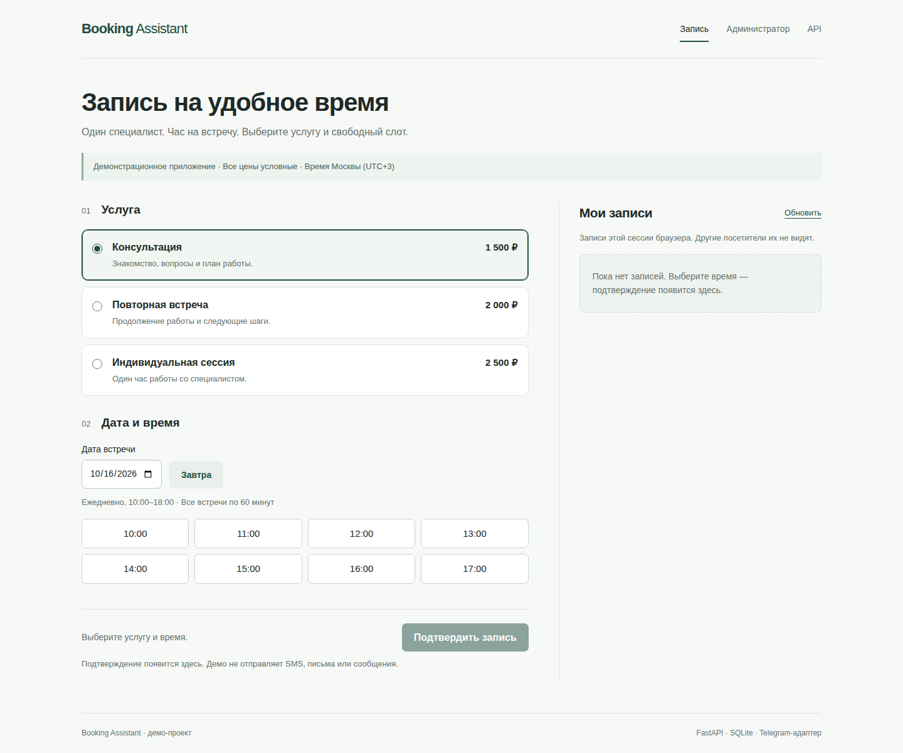
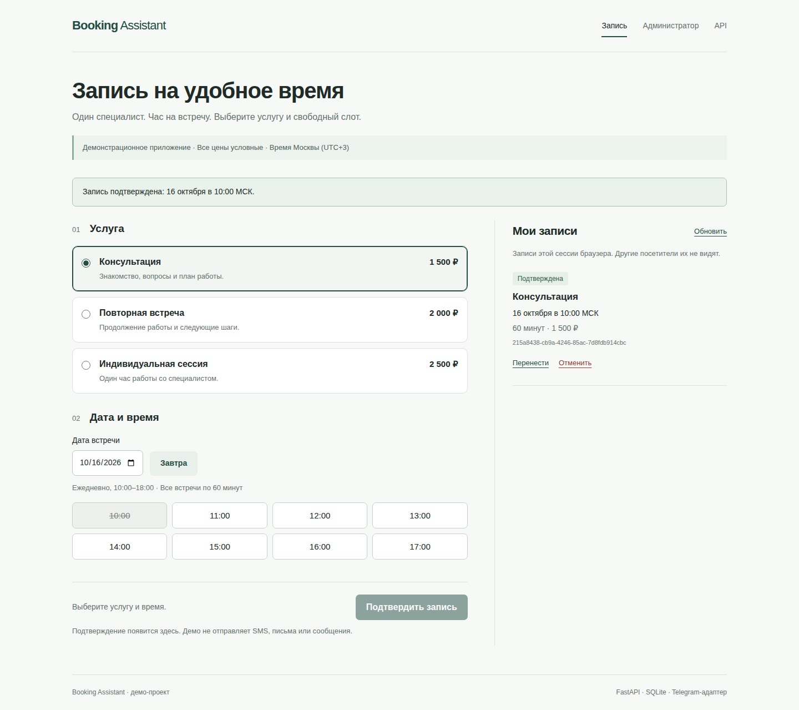
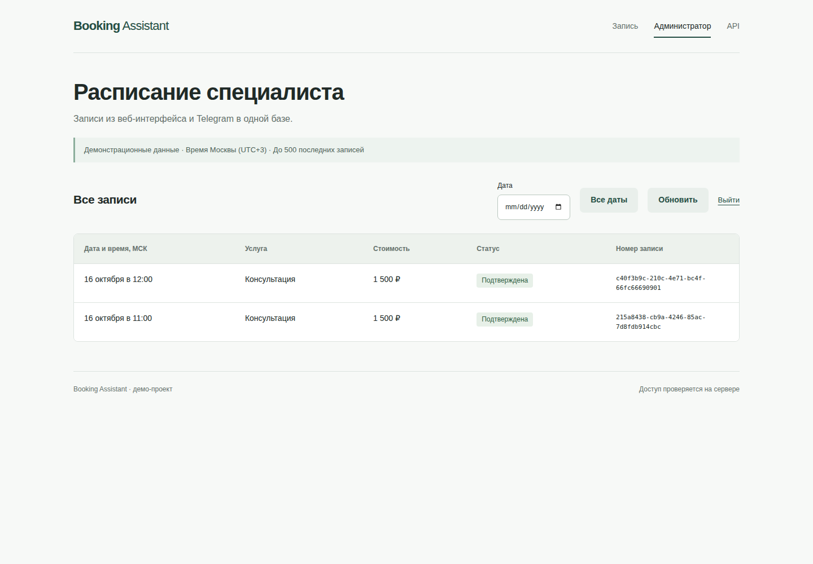

# Скриншоты работающего приложения

Снимки получены автоматическим Chromium-прогоном в GitHub Actions, а не сгенерированы как макеты.

- Исходный коммит: [`f69bfb837f28803db3d3d0b2cc2fe2e561e2b9fa`](https://github.com/snijar/booking-assistant/commit/f69bfb837f28803db3d3d0b2cc2fe2e561e2b9fa).
- [Успешный прогон CI](https://github.com/snijar/booking-assistant/actions/runs/38702819177), 15 октября 2026.
- Изолированная настоящая SQLite; сетевые запросы Telegram не выполнялись.
- Проверены 13 браузерных сценариев; `browser-result.json` — вывод скрипта.
- Размеры: 390, 768, 1440 px. Время браузера при проверке — New York; интерфейс явно отображает Москву.
- SHA-256 скачанного CI-архива совпал с digest GitHub: `f8470a1a019ca1c505fe1e38bbc657722c7d56348c9e06af8d64c985dc771edd`.

[Мобильная запись](booking-390.png) · [Мобильный администратор](admin-390.png) · [Запись, 768 px](booking-768.png) · [Администратор, 768 px](admin-768.png)

Публичный backend не размещён: эти изображения показывают тестовый запуск в CI. Для самостоятельной проверки используйте команды основного README.

